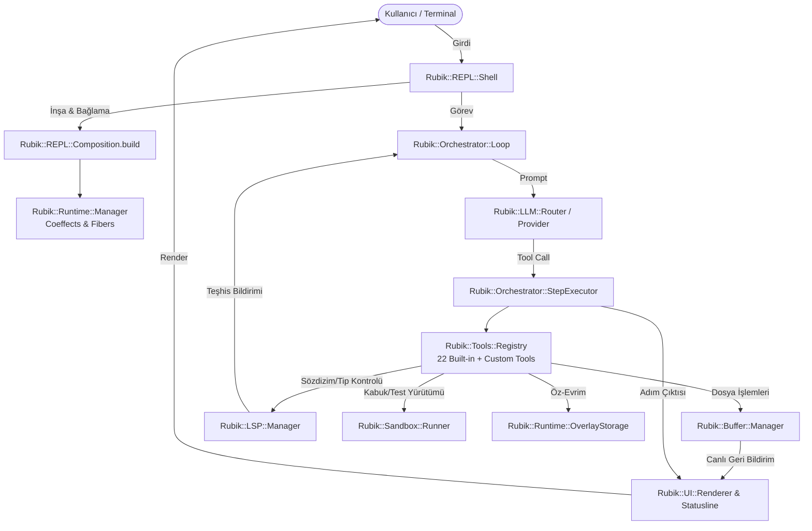

# 🏛️ Rubik Sistem Mimarisi (System Architecture)

> **Protokol:** [`AGENTS.md`](AGENTS.md) — Spatiotemporal Composability & Self-Evolving Runtimes  
> **İlgili Kılavuzlar:** [`TOOLS.md`](TOOLS.md) · [`SELF_EVOLUTION.md`](SELF_EVOLUTION.md) · [`PLUGINS.md`](PLUGINS.md) · [`COMMANDS.md`](COMMANDS.md) · [`CONFIG.md`](CONFIG.md)

---

## 📖 1. Sistem Genel Bakışı ve Tasarım Felsefesi

Rubik, saf Ruby (3.3+) ile yazılmış, **Spatiotemporal Composability & Self-Evolving Runtime** mimarisi üzerine kurulu modüler bir otonom kodlama harness'ıdır.

### Temel Mimari İlkeler:
1. **Spatiotemporal Composability (Revertible Effects & Reactive Coeffects):** Sistemdeki her işlem bir uzay-zaman bağlamında izole edilir; her yan etki LIFO ($\Omega$) ters işlem kaydıyla atomik olarak geri alınabilir.
2. **In-Memory Virtual Buffer First:** Model kod yazdığında dosyalar doğrudan diske yazılmaz; sanal tamponda hazırlanır. Sıfır riskli manipülasyon, snapshot geçmişi ve anında geri alma (`!undo`) sunar.
3. **Pure-Ruby Cross-Platform Core:** POSIX (Linux, macOS) ve Windows 11 ortamlarında harici native bağımlılık olmadan sorunsuz çalışır.

---

## 🧩 2. 22 Çekirdek Domain Sözlüğü ve Sorumluluk Matrisi

Rubik'in `lib/rubik/` dizini altındaki 22 bağımsız alt sistemi:

| # | Domain | Modül / Sınıf | Sorumluluk & Görev |
| :--- | :--- | :--- | :--- |
| 1 | **`adapter`** | `Rubik::Adapter` | Çok dilli test, lint ve format çalıştırma adaptörleri (Ruby, Python, Go, Rust, TS vb.). |
| 2 | **`ast`** | `Rubik::AST` | Prism (Ruby) ve Tree-Sitter (10 poliglott dil) hibrit motoru, semantik sembol ve çağrı grafı (`Graph`), kalıcı JSON disk önbelleği. |
| 3 | **`benchmark`**| `Rubik::Benchmark` | Ajan performans ve kabul kıyaslama test çatısı. |
| 4 | **`buffer`** | `Rubik::Buffer` | Bellek içi sanal tampon (`Manager`), snapshot geçmişi, LIFO undo ve diff motoru. |
| 5 | **`config`** | `Rubik::Config` | Katmanlı YAML yapılandırma (defaults, deep ops, store, schema validation). |
| 6 | **`context`** | `Rubik::Context` | Kod haritası, AST indeksleme, token tahmini ve akıllı compaction/pruning. |
| 7 | **`diagnostics`**| `Rubik::Diagnostics` | Elm-tarzı hata formatlayıcı, `ExecutionFailure` sınıflandırması ve geri bildirim. |
| 8 | **`event_bus`**| `Rubik::EventBus` | Asenkron ve senkron olay yayın/abone (`Pub/Sub`) omurgası. |
| 9 | **`llm`** | `Rubik::LLM` | Sağlayıcı soyutlamaları (OpenAI, Claude, Ollama, Custom), model yönlendirici (`Router`). |
| 10 | **`lsp`** | `Rubik::LSP` | Dil sunucusu yöneticisi, RFC 8089 URI desteği, bellek içi canlı tanı. |
| 11 | **`orchestrator`**| `Rubik::Orchestrator`| Ajan döngüsü (`Loop`; subagent bildirim kuyruğu `SubagentNoticeInbox` işbirlikçisinde — doğrulama, race-safe drenaj ve run/continue yaşam döngüsü), `ShellDeps` (daraltıcı façade), `StepExecutor`, `BudgetManager`, `StreamManager`, `ProviderResolver`, `ActivityLog`, `SubagentNoticeInbox`, `ToolCallId` (tool-call kimlik damgasının tek evi), `Subagent::Supervisor` (Linux init-0 modeli), `Subagent::Instance`, `Subagent::StepRunner`, `Subagent::TypeRegistry`, `Subagent::Notices` (bildirim sözlüğünün tek evi: kullanıcı/model kanal ayrımı), `Subagent::Budget` (adım bütçesi durum makinesi + grant normalizasyonu ve grant-notu sözlüğü — subagent-döngü hedef kitle sınırı; `BudgetManager`'ın sahipli varyantı, stateless-over-owner doktriniyle ayrı kalırlar). |
| 12 | **`platform`** | `Rubik::Platform` | Çapraz platform yardımcıları (`PATHEXT`, `which`, `kill_tree`, `path_under?`). |
| 13 | **`plugin`** | `Rubik::Plugin` | Drop-in eklenti depolama (`Storage`), `Rubik.plugin` DSL'i ve `$LOAD_PATH` refcount. |
| 14 | **`prompt`** | `Rubik::Prompt` | Sistem istemi oluşturucular (`ContextBuilder`), `<operational_rules>` (Kural 1-8 High-SNR), dinamik XML etiketleri (`<subagents>`, `<workspace_status>`, `<buffer_status>`). |
| 15 | **`repair`** | `Rubik::Repair` | Kendi kendini onaran çalışma zamanı döngüleri ve teşhis tabanlı düzeltme. |
| 16 | **`repl`** | `Rubik::REPL` | Etkileşimli kabuk (`Shell`), 11 domain komut modülü (`system`, `buffer`, `tasks`, `subagents` vb.), sunum katmanı, `ServiceCatalog` (hizmet tanım kataloğu: yeni servis = Coeffects anahtarı + tek katalog girdisi; Parts üyeleri, ivar'lar, reader'lar ve provide satırları girdiden türetilir — Candidate 05). |
| 17 | **`runtime`** | `Rubik::Runtime` | Spatiotemporal `Context`, `Fiber` durum makinesi, LIFO $\Omega$ akümülatörü, `OverlayStorage`, `TaskManager` (`RingBuffer` & asenkron süreçler), `ServiceDefinition` (hizmet bildirimi value-object sözlüğü), `ServiceRegistration` (4 register-shim'in ortak omurgası: ctx çıkarma → provide → inverse → reconcile). |
| 18 | **`sandbox`** | `Rubik::Sandbox` | Safe Execution (her zaman aktif), tak-çıkar OS sandbox (bwrap/docker/podman/firejail), dinamik kayıt defteri. |
| 19 | **`security`** | `Rubik::Security` | Güvenlik muhafızı (`Guard`), Tree-Sitter AST komut sınıflandırıcı (168 CLI YAML, Bash/Pwsh), boru hattı zehirleme ve kritik yol engelleri. |
| 20 | **`session`** | `Rubik::Session` | Oturum kaydedici (`Recorder`), JSONL loglama ve `rubik -c` devamlılığı. |
| 21 | **`tools`** | `Rubik::Tools` | 29 yerleşik araç, araç kayıt defteri (`Registry`), Elm-tarzı yönlendirici hata formatı, `Services` (araç katmanı triple-chain çözümleme görünümü: kwarg → coeffect → fresh; standalone kurulum fail-closed kalır). |
| 22 | **`ui`** | `Rubik::UI` | TUI katmanı, canlı spinner, statusline, diff renklendirici, markdown renderer. |

---

## 🏗️ 3. Sistem Montaj Hattı (`Composition.build`) ve Veri Akışı

Rubik, tüm bu alt sistemleri `Composition.build` montaj katmanında deterministik sırada ayağa kaldırır:

---

## 🛡️ 4. Tasarım Değişmezleri (Invariants)

1. **Tampon Güvencesi (Buffer Invariant):** Model tarafından yapılan tüm kod değişiklikleri diske doğrudan yazılmaz; `Buffer::Manager` sanal katmanında tutulur ve yalnızca `apply_buffer` (`!apply`) işlemiyle diske aktarılır.
2. **LIFO Ters İşlem Garantisi ($\Omega$):** Çalışma zamanında üretilen her araç (`synthesize_tool`) veya servis kaydı (`ctx.provide`), yaşam döngüsü bittiğinde ters sırayla temizlenir.
3. **Çoklu Platform Saydamlığı:** Dosya yolları, işlem sonlandırma ağaçları (`kill_tree`) ve kabuk çağrıları platforma göre şeffaf bir şekilde yönetilir.

---

## 💎 5. Saf Ruby & Sıfır-Native Bağımlılık Mimarisi

Rubik, Windows, macOS ve Linux sistemlerinde **harici C derleyicisi (GCC, Clang, MSVC) veya C-extension derleme adımı gerektirmeden** sıfır-kurulum çalışacak şekilde tasarlanmıştır:
- **Ruby AST:** Ruby 3.3+ ile yerleşik gelen resmi **Prism** ayrıştırıcısını kullanır; harici native gem bağımlılığı yoktur.
- **Çok Dilli Tree-Sitter AST & Hibrit Semantik Motoru:** Python, Go, Rust, TypeScript, TSX, JavaScript, C, C++ ve Zig dillerinde `tree_sitter_language_pack` ile derlenmiş C/Rust çekirdekli gramerler üzerinden tam sözdizim ağacı ayrıştırması yapar; yorum/string içi süslü parantez tuzaklarına ve modern dil kalıplarına karşı dayanıklıdır. Ağ veya kütüphane erişilemezliği durumunda sessizce eski regex çıkarıcılara (`FallbackCleaner`) geri çekilen fail-safe graceful fallback mimarisiyle çalışır.
- **Dil Sunucusu Desteği (LSP):** İleri düzey tip ve semantik analiz için harici native derleme yerine sistemde kurulu standart dil sunucularına (`gopls`, `rust-analyzer`, `solargraph`, `pyright` vb.) RFC 8089 uyumlu JSON-RPC ile bağlanır.
- **Güvenli Komut AST (Safe Execution):** Bash ve PowerShell komutlarını çalıştırmadan önce `tree_sitter` gem'i ve derlenmiş gramerlerle AST düzeyinde çözümler; 168 CLI aracı için yapılandırılmış kurallarla boru hattı zehirlemesi, kök dizin yazımı ve tehlikeli bayrakları yakalar; başarısızlık durumunda fail-safe regex fallback devreye girer.

---

## 🔒 6. Eşzamanlılık (Thread-Safety) ve Devre Kesici (Circuit Breaker)

- **Re-entrant Buffer Senkronizasyonu:** `Buffer::Manager`, eşzamanlı arka plan AST indeksleme ve çoklu fiber erişimlerine karşı `Monitor` ile korunur.

---

## 🪟 7. ShellDeps — Arayüz-Daraltıcı Façade ve PR Kontrol Listesi

> Kaynak: `_reviews/2026-09-14-architectural-review.md` Öneri 3 (kontrol listesi)
> ve Bulgu 2 (façade belgelemesi). Require-seviyesi değişmezler
> (`orchestrator/runtime/tools/llm → repl` yok) CI'da
> `test/unit/test_architectural_boundaries.rb` ile zorlanır; aşağıdaki liste
> statik analizin göremediği metot-seviyesi coupling içindir.

### 7.1 `Orchestrator::ShellDeps` (`lib/rubik/orchestrator/shell_deps.rb`)

`Loop` tarafından inşa edilen tüm işbirlikçiler — `StepExecutor`,
`BudgetManager`, `StreamManager` — Loop durumuna **yalnızca bu façade
üzerinden** erişir; ham `@loop` reach-through yasaktır (Law of Demeter).
Loop kendisi `@shell_deps = ShellDeps.new(self)` ile façade'i tutar ve
işbirlikçilerine enjekte eder.

| Yüzey | Semantik | Örnekler |
| :--- | :--- | :--- |
| `SURFACE` (okuma) | Loop erişimcileri `method_missing` + `respond_to_missing?` ile **iletilir**, yeniden beyan edilmez — test dublörleri minimal kalır, `deps.respond_to?(...)` sorguları gerçek semantiği korur | `deps.provider`, `deps.history`, `deps.step_count`, `deps.safe_config` |
| Komut yüzeyi (yazma) | Loop'un `attr_accessor` alanları sızdırılmaz; mutasyonlar adlandırılmış komutlardır | `replace_history!`, `reset_invalid_tools!`, `record_invalid_tool!`, `mark_last_turn_streamed!`, `flag_context_warning!`, `emergency_compact_and_notify!` |
| `loop_instance` | Yalnızca tur-sonuç sözleşmesi: sonuç hash'i Loop nesnesini taşır, Shell devamı `continue_loop` ile sürdürür | `turn_result` |

**Kurallar:**
1. İşbirlikçi kurulumu `ShellDeps.wrap(loop_or_deps)` ile yapılır; façade ya da
   çıplak loop (test dublörü) kabul edilir.
2. Loop'a erişilebilir yeni durum eklenirken önce kategori seçilir: salt-okuma
   ise `SURFACE`'e, mutasyon ise adlandırılmış komut metoduna. Yeni bir public
   Shell metodu Loop'tan çağrılacaksa 7.2'deki ikinci madde işletilir.
3. Davranış kilidi: `test/unit/test_shell_deps.rb` (SURFACE iletimi, komut
   yüzeyi, `respond_to?` sözleşmesi, minimal dublör uyumu).
4. Kaynak-guard kilidi (Bulgu 5): işbirlikçilerde çıplak `@loop` ivarı yasak —
   Loop durumuna erişim yalnızca ShellDeps üzerinden
   (`test_no_raw_loop_ivar_reach_through_in_collaborators`); Loop'un
   `@shell'e dokunuşları gerekçeli beyaz listeyle sınırlı
   (`test_loop_shell_touches_stay_on_the_allowlist`; constructor ataması,
   config/commands sözleşme okumaları — `buffer.auto_apply` okuması 2026-09-22
   birleştirmesinde `Orchestrator::AutoApply`'e taşındı, beyaz liste küçüldü).

### 7.2 PR İnceleme Kontrol Listesi (Shell / Loop Büyüme Disiplini)

`lib/rubik/repl/shell.rb` veya `lib/rubik/orchestrator/loop.rb` dokunulan
her PR'da inceleyici şunları sorar:

- [ ] **Yeni davranış mixin'e mi, çekirdeğe mi?** Shell'e yeni bir public
      metot/ömür döngüsü davranışı eklerken önce mixin evi sorulur:
      lifecycle, presentation, config_wiring, composition, hooks,
      confirmations, turn_recorder. Çekirdek sınıfa ek yalnızca sınıflar-arası
      orkestrasyon kodu içindir.
- [ ] **Loop yeni Shell yüzeyine mi dokunuyor?** Orchestrator'dan Shell'e
      erişim yalnızca `ShellDeps` daraltıcı üzerinden. Yeni bir Shell metodu
      Loop'tan çağrılacaksa önce ShellDeps `SURFACE`'e eklenip eklenmeyeceği
      tartışılır; doğrudan `shell.xxx` reach-through red sebebidir. CI'da
      kaynak-guard ile kilitli: işbirlikçilerde çıplak `@loop` yasağı +
      `loop.rb`'de `@shell` beyaz listesi (`test_architectural_boundaries.rb`).
      Yeni bir `@shell` dokunuşu gerekçesini PR'da yazar ve guard beyaz
      listesine açıkça ekler.
- [ ] **Yeni bir işbirlikçi çıkarılmalı mı?** Aynı sorumlulukta ≥2 özel metot
      birikmişse (örn. provider-config → `ProviderResolver`), ShellDeps/StepExecutor
      deseni izlenir: dar yapıcı enjeksiyonu + Loop'ta private delegasyon şimleri.
- [ ] **Satır/sembol bütçesi:** PR, Shell'i ~600 satırın veya Loop'u ~400
      satırın üzerine çıkarıyorsa gerekçe zorunludur; aksi hâlde çıkarma
      (extraction) planlanır.

### 7.3 `REPL::CommandContext` — Komut Ekseninde Daraltıcı (Candidate 06)

Bang-komut işleyicileri tüm Shell'i değil, her dispatch'te inşa edilen
`Rubik::REPL::CommandContext`'i alır (`handler.call(args, ctx)`); inşaat
`InputExecution#execute_command` içinde, `with_output(TeeIO...)` yakalama
takasından SONRA yapılır — böylece `ctx.out` her zaman kayıt/LLM-geçmişi
yakalamasına akan IO'dur. Yüzey kapalıdır: servis okuyucuları
`ServiceCatalog.reader_names`'den türetilir (ikinci liste yok),
`conversation_history` / `active_loop` write-through erişicilerle
yeniden bağlanabilir, geri kalan her şey adlandırılmış tek satırlık etkidir.
`register_command`, ivar erişimi, `respond_to?` keşfi ve `method_missing`
yoktur. Komut modüllerinde çıplak `shell` yalnızca kayıt omurgasında
(`def self.register(shell)` + `shell.register_command`) görünebilir;
kilit: `test_repl_command_context_guard.rb` (omurga beyaz listesi +
ivar yasağı + katalog-türetme + allowlist-rot öz-denetimi) ve kapalı
yüzey dondurması `test_command_context.rb`. Kullanım özetleri omurgada
`usage:` meta verisi olarak tek-tapuludur; `!help <cmd>` bunu basar.
Özel komut dispatch'leri (SynthesizeCommandTool, OverlayStorage#eval_command,
PreflightRunner) 2-arity'ye ctx (IO-ördeği), 3-arity'ye ham shell verir.
