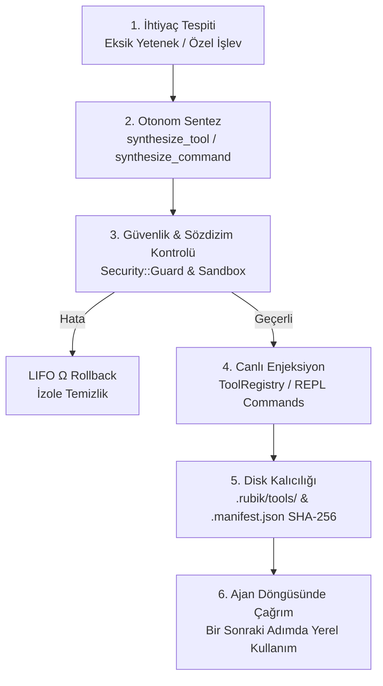

# 🧬 LLM Autonomous Self-Evolution Guide

> **Protocol:** [`AGENTS.md`](AGENTS.md) — Spatiotemporal Composability & Self-Evolving Runtimes  
> **Related Guides:** [`PLUGINS.md`](PLUGINS.md) · [`TOOLS.md`](TOOLS.md) · [`ARCHITECTURE.md`](ARCHITECTURE.md)

---

## 📖 1. Introduction and Self-Evolution Philosophy

Rubik is not a static agent framework with pre-drawn boundaries. When faced with complex or unpredictable tasks (for example a custom AST transformer, a data format converter, or a benchmark measurer), it **can dynamically generate, validate, and inject its own tools and plugins into the live system at runtime.**

This capability is safeguarded by the principles of Spatiotemporal Composability: no synthesis operation ever resets the existing conversation history, the AST symbol graph, or session memory (Zero-Downtime Hot-Swapping).

---

## 🔄 2. End-to-End Self-Evolution Lifecycle



### Lifecycle Stages:

1. **Needs Analysis:** The LLM identifies a problem that cannot be solved, or is solved inefficiently, with the existing 33 built-in tools.
2. **Synthesis (`synthesize_tool` / `synthesize_command` / `define_subagent`):** The model dynamically produces the function code, the REPL command, or the subagent archetype.
3. **Preflight Validation in an Isolated Process (`PreflightRunner`):** Runtime preflight validation is mandatory for `synthesize_tool` calls;
   if `test_args` is not specified, the tool is tested with the default `{}` arguments. The generated code is validated by executing it in a
   short-lived child `ruby` process; runaway code that outlives its 5-second envelope is cleaned up by hard-killing the process — even if
   it is a C extension or is blocked on a syscall (`Timeout.timeout` cannot do this). If the child process cannot be spawned, validation
   continues in-process with `Timeout` — inside an isolated sub-context (`ctx.extend()`) when the runtime context is reachable, or directly
   otherwise. Tools that fail preflight are never added to the toolbelt.
4. **Toolbelt Injection:** The validated tool is added live onto `@tool_registry` (`register`).
5. **Persistence (.rubik/tools/):** The code is written to the `.rubik/tools/<name>.rb` file and its SHA-256 digest is recorded in `.manifest.json`.
6. **LIFO Rollback Guarantee:** If an error occurs during synthesis (`SyntaxError`, a security violation), the partial side effects are reverted immediately ($\Omega$).

---

## 💻 3. Real Code and Scenario Examples

### A. Live Tool Synthesis (`synthesize_tool`)

When the model needs an AST complexity analysis tool, it issues a `synthesize_tool` call with the following JSON payload:

```json
{
  "tool": "synthesize_tool",
  "args": {
    "name": "ast_cyclomatic_complexity",
    "description": "Calculates cyclomatic complexity for all Ruby methods in a file",
    "scope": "project",
    "risk": "read",
    "params_schema": {
      "type": "object",
      "properties": {
        "path": { "type": "string", "description": "Target file path" }
      },
      "required": ["path"]
    },
    "code": "->(args) { path = args['path']; count = File.read(path).scan(/\\b(if|unless|while|until|def|rescue)\\b/).size; \"Complexity Score for #{path}: #{count}\" }",
    "test_args": { "path": "lib/rubik.rb" }
  }
}
```

**Result:** The `ast_cyclomatic_complexity` tool is injected into the `@tool_registry` instantly. On the next step, the model can call the tool as a local function via `ast_cyclomatic_complexity(path: 'lib/rubik/config.rb')`.

---

### B. Live REPL Command Synthesis (`synthesize_command`)

Producing a new `!` bang command that the user can run in the REPL:

```json
{
  "tool": "synthesize_command",
  "args": {
    "name": "doc_toc",
    "description": "Print the first 5 markdown headings of a document",
    "scope": "project",
    "code": "->(args, output, shell) { output.puts File.readlines(args.first || 'README.md').grep(/^##/).first(5) }"
  }
}
```

It can be run by the user typing `!doc_toc` in the REPL, or by the agent calling `exec_repl_command('!doc_toc')`. Note: process spawning in synthesized code (`system`, backticks, `IO.popen`) is blocked by the security firewall; use the REPL's `!sh` command for shell commands.

---

### C. Drop-in Plugin Synthesis with the Plan 68 `Rubik.plugin` DSL

For more comprehensive plugins, the agent can write them straight into the `.rubik/plugins/` directory with the `write_file` tool and load them with zero downtime via `!plugin add`:

```ruby
# .rubik/plugins/metric_collector.rb
Rubik.plugin(:metric_collector, version: "1.0.0", description: "Gelişmiş metrik toplayıcı", inject: [:tools, :shell]) do |ctx|
  shell = ctx.require(:shell)
  tools = ctx.require(:tools)

  # 1. Geri alınabilir özel araç kaydı
  metric_tool = Class.new(Rubik::Tools::BaseTool) do
    def initialize
      super(name: "collect_metrics", description: "Collects LOC metrics", risk: :read)
    end

    def execute(args = {})
      "LOC Metric: 100% healthy"
    end
  end.new

  tools.register(metric_tool)

  # 2. LIFO Ters Etki Temizleyicisi (Ω)
  ctx.on_dispose do
    tools.unregister("collect_metrics")
    shell.output.puts "🧹 MetricCollector temizlendi."
  end
end
```

---

## 🛡️ 4. Security Guardrails

1. **Critical Code Audit (`Security::Guard`):** Synthesized code goes through static analysis against patterns such as `rm -rf`, `eval`, `system`, disk formatting, or writes to sensitive system directories.
2. **SHA-256 Integrity Verification:** Files under `.rubik/tools/` or `.rubik/plugins/` are verified against the digests in `.manifest.json`; externally modified files are rejected (`RUBIK_TRUST_OVERLAYS=1` is the development escape hatch).
3. **One-Time Bootstrap Gate:** Overlay files carrying sentinel headers (`# Rubik Custom Command:` / `# Rubik Custom Tool:`) are accepted on the first scan only when the `.manifest.json` file **does not exist at all** and `RUBIK_BOOTSTRAP_OVERLAYS=1` gives explicit consent, and a `[BOOTSTRAP]` notice is printed; without consent the files are skipped and a one-line notice is shown. Once the manifest exists, headed files dropped in manually afterwards — forged headers included — are rejected; handwritten overlays must be registered through the synthesis flow, the one-time `RUBIK_BOOTSTRAP_OVERLAYS=1`, or the `RUBIK_TRUST_OVERLAYS=1` escape hatch. **When cloning a foreign repository, audit the `.rubik/` directory** — overlays without a manifest are not loaded unless consent is given. A corrupted (invalid JSON) manifest excludes the entire directory for that launch (with a `[SECURITY]` warning) and refuses to write new registrations; the remedy is to delete the manifest (a deliberate one-time re-bootstrap). Command/tool loading failures are surfaced with an `[OVERLAY]` warning.
4. **Elm-Style Diagnostic Support:** When an agent calls a missing or non-existent tool, the system suggests how it could produce the tool with `synthesize_tool` instead of returning a bare error.
