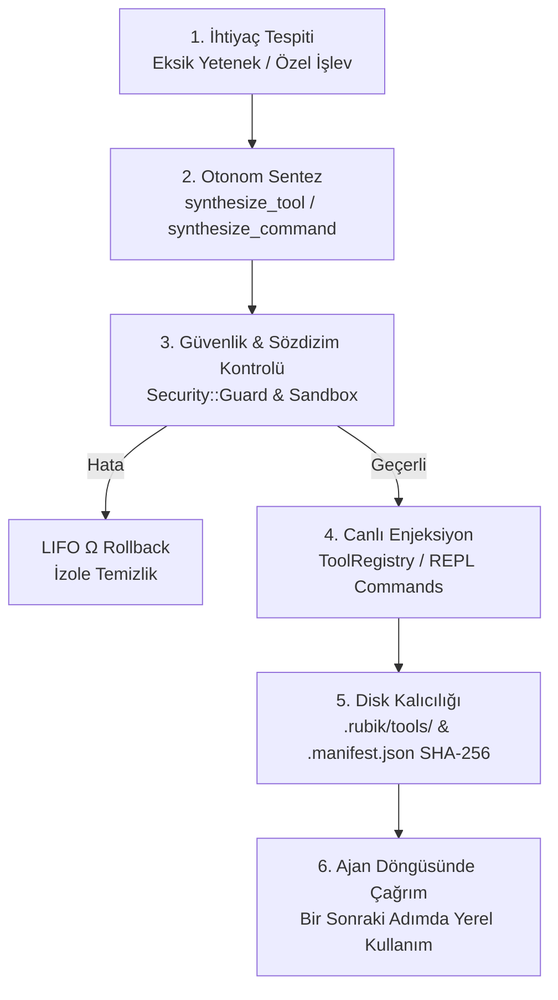

# 🧬 LLM Otonom Öz-Evrim Kılavuzu (Self-Evolution Guide)

> Bu belge, [`SELF_EVOLUTION.md`](SELF_EVOLUTION.md) dosyasının Türkçe çevirisidir ve güncelliğini yitirmiş olabilir; çelişki halinde İngilizce sürüm esastır.

> **Protokol:** [`AGENTS.md`](AGENTS.md) — Spatiotemporal Composability & Self-Evolving Runtimes  
> **İlgili Kılavuzlar:** [`PLUGINS.md`](PLUGINS.md) · [`TOOLS.md`](TOOLS.md) · [`ARCHITECTURE.md`](ARCHITECTURE.md)

---

## 📖 1. Giriş ve Öz-Evrim Felsefesi

Rubik, statik ve sınırları önceden çizilmiş bir ajan çerçevesi değildir. Karşılaştığı karmaşık veya öngörülemeyen görevlerde (örneğin özel bir AST dönüştürücüsü, veri formatı çeviricisi veya benchmark ölçümcüsü) **çalışma zamanında kendi araçlarını ve eklentilerini dinamik olarak üretebilir, doğrulayabilir ve canlı sisteme enjekte edebilir.**

Bu yetenek Spatiotemporal Composability ilkeleriyle korunur: hiçbir sentezleme işlemi var olan konuşma geçmişini, AST sembol grafını veya oturum belleğini sıfırlamaz (Zero-Downtime Hot-Swapping).

---

## 🔄 2. Uçtan Uca Öz-Evrim Yaşam Döngüsü



### Yaşam Döngüsü Aşamaları:

1. **İhtiyaç Analizi:** LLM, mevcut 33 yerleşik araçla çözülemeyen veya verimsiz çözülen bir problemi tespit eder.
2. **Sentezleme (`synthesize_tool` / `synthesize_command` / `define_subagent`):** Model, fonksiyon kodunu, REPL komutunu veya alt ajan arketipini dinamik olarak üretir.
3. **İzole Süreçte Ön-Doğrulama (`PreflightRunner`):** `synthesize_tool` çağrılarında çalışma zamanı ön-doğrulaması zorunludur;
   `test_args` belirtilmemişse varsayılan `{}` argümanları ile test edilir. Üretilen kod, kısa ömürlü bir alt
   `ruby` sürecinde çalıştırılarak doğrulanır; 5 saniyelik zarfı dolan kaçan kod, C-uzantısı veya engelleyen
   syscall olsa bile süreç sertçe öldürülerek temizlenir (`Timeout.timeout` bunu yapamaz). Alt süreç
   açılamazsa doğrulama in-process `Timeout` ile sürer — runtime bağlamı erişilebilirse izole alt bağlamda
   (`ctx.extend()`), erişilemezse doğrudan. Pre-flight'tan geçemeyen araçlar kesinlikle toolbelt'e eklenmez.
4. **Toolbelt Enjeksiyonu:** Doğrulanan araç, `@tool_registry` üzerine canlı olarak eklenir (`register`).
5. **Kalıcılık (.rubik/tools/):** Kod `.rubik/tools/<name>.rb` dosyasına yazılır ve SHA-256 özeti `.manifest.json` dosyasına kaydedilir.
6. **LIFO Rollback Güvencesi:** Sentezleme sırasında bir hata olursa (`SyntaxError`, güvenlik ihlali), kısmi yan etkiler anında geri alınır ($\Omega$).

---

## 💻 3. Gerçek Kod ve Senaryo Örnekleri

### A. Canlı Araç Sentezi (`synthesize_tool`)

Model bir AST karmaşıklık analizi aracına ihtiyaç duyduğunda şu JSON yüküyle `synthesize_tool` çağrısı yapar:

```json
{
  "tool": "synthesize_tool",
  "args": {
    "name": "ast_cyclomatic_complexity",
    "description": "Calculates cyclomatic complexity for all Ruby methods in a file",
    "scope": "project",
    "risk": "read",
    "params_schema": {
      "type": "object",
      "properties": {
        "path": { "type": "string", "description": "Target file path" }
      },
      "required": ["path"]
    },
    "code": "->(args) { path = args['path']; count = File.read(path).scan(/\\b(if|unless|while|until|def|rescue)\\b/).size; \"Complexity Score for #{path}: #{count}\" }",
    "test_args": { "path": "lib/rubik.rb" }
  }
}
```

**Sonuç:** `ast_cyclomatic_complexity` aracı anında `@tool_registry` içine eklenir. Model bir sonraki adımda `ast_cyclomatic_complexity(path: 'lib/rubik/config.rb')` şeklinde aracı yerel fonksiyon olarak çağırabilir.

---

### B. Canlı REPL Komutu Sentezi (`synthesize_command`)

Kullanıcının REPL'de çalıştırabileceği yeni bir `!` bang komutu üretme:

```json
{
  "tool": "synthesize_command",
  "args": {
    "name": "doc_toc",
    "description": "Print the first 5 markdown headings of a document",
    "scope": "project",
    "code": "->(args, output, shell) { output.puts File.readlines(args.first || 'README.md').grep(/^##/).first(5) }"
  }
}
```

Kullanıcı REPL'de `!doc_toc` yazarak veya ajan `exec_repl_command('!doc_toc')` çağırarak çalıştırabilir. Not: sentezlenen kodda süreç başlatma (`system`, backtick, `IO.popen`) güvenlik duvarı tarafından engellenir; kabuk komutları için REPL'in `!sh` komutunu kullanın.

---

### C. `Rubik.plugin` DSL ile Drop-in Eklenti Sentezi

Ajan, daha kapsamlı eklentileri `write_file` aracıyla doğrudan `.rubik/plugins/` dizinine yazıp `!plugin add` ile sıfır kesintiyle yükleyebilir:

```ruby
# .rubik/plugins/metric_collector.rb
Rubik.plugin(:metric_collector, version: "1.0.0", description: "Gelişmiş metrik toplayıcı", inject: [:tools, :shell]) do |ctx|
  shell = ctx.require(:shell)
  tools = ctx.require(:tools)

  # 1. Geri alınabilir özel araç kaydı
  metric_tool = Class.new(Rubik::Tools::BaseTool) do
    def initialize
      super(name: "collect_metrics", description: "Collects LOC metrics", risk: :read)
    end

    def execute(args = {})
      "LOC Metric: 100% healthy"
    end
  end.new

  tools.register(metric_tool)

  # 2. LIFO Ters Etki Temizleyicisi (Ω)
  ctx.on_dispose do
    tools.unregister("collect_metrics")
    shell.output.puts "🧹 MetricCollector temizlendi."
  end
end
```

---

## 🛡️ 4. Güvenlik Koruma Duvarları (Guardrails)

1. **Kritik Kod Denetimi (`Security::Guard`):** Sentezlenen kodlar `rm -rf`, `eval`, `system`, disk formatlama veya hassas sistem dizinlerine yazma desenlerine karşı statik analizden geçer.
2. **SHA-256 Bütünlük Doğrulaması:** `.rubik/tools/` veya `.rubik/plugins/` altındaki dosyalar `.manifest.json` içindeki özetle doğrulanır; dışarıdan değiştirilmiş dosyalar reddedilir (`RUBIK_TRUST_OVERLAYS=1` geliştirme kaçış kapısıdır).
3. **Tek Seferlik Bootstrap Kapısı:** Sentinel başlıklı overlay dosyaları (`# Rubik Custom Command:` / `# Rubik Custom Tool:`) yalnızca `.manifest.json` dosyası **hiç yokken** ve `RUBIK_BOOTSTRAP_OVERLAYS=1` açık rızasıyla ilk taramada kabul edilir ve `[BOOTSTRAP]` bildirimi basılır; rıza verilmezse dosyalar atlanır ve tek satırlık bildirim gösterilir. Manifest bir kez oluştuğunda, sonradan el ile bırakılan başlıklı dosyalar — sahte başlık dahil — reddedilir; el yazımı overlay'ler sentez akışıyla, tek seferlik `RUBIK_BOOTSTRAP_OVERLAYS=1` ile veya `RUBIK_TRUST_OVERLAYS=1` kaçış kapısıyla kayıt altına alınmalıdır. **Yabancı bir depoyu klonlarken `.rubik/` dizinini denetleyin** — manifest'siz overlay'ler rıza verilmedikçe yüklenmez. Bozuk (geçersiz JSON) bir manifest, o açılışta tüm dizini dışlar (`[SECURITY]` uyarısı) ve yeni kayıt yazmayı reddeder; çare manifesti silmektir (kasıtlı tek seferlik yeniden bootstrap). Komut/araç yükleme hataları `[OVERLAY]` uyarısıyla görünür kılınır.
4. **Elm-Tarzı Tanılama Desteği:** Bir ajan var olmayan veya eksik bir araç çağırdığında sistem ona kuru bir hata dönmek yerine `synthesize_tool` ile aracı nasıl üretebileceğini önerir.
